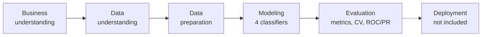

# Customer Churn Prediction

**Author:** Andressa Avelar Belo · [LinkedIn](https://linkedin.com/in/andressaavelar) · [GitHub](https://github.com/aavelarbelo) · eng.belo@gmail.com

End-to-end customer churn prediction for a telecom operator using CRISP-DM, exploratory data
analysis, preprocessing and supervised machine learning models.


> The work started as part of the **Data Mining** course unit, in the Post-Graduation in Big Data
> and Decision Making at ISEP, and was developed further as a technical portfolio project, with a
> focus on reproducibility, documentation, and comparison of classification models.
>
> **Status:** EDA, preprocessing and modeling are complete. Four classification models were
> trained, compared and evaluated (results below). Next steps focus on refactoring the code into
> reusable scripts and adding hyperparameter tuning.

## The problem

Customer retention is an important challenge for telecommunications companies, because keeping
an existing customer is usually cheaper than acquiring a new one.

The goal is to identify, based on contract and service-usage data, which customers have a higher
probability of canceling the service. This prediction can support preventive retention actions,
such as targeted campaigns, plan reviews, personalized offers, or proactive contact with at-risk
customers.

In this type of problem, the **recall** metric is especially important, because failing to
identify a customer who is about to leave can represent a direct loss of revenue.

## Dataset

The project uses the public **Telco Customer Churn** dataset, frequently used in classification
and churn-prediction studies. The working dataset contains **5,042 customer records** and 21
original variables.

| Group | Examples of variables | Description |
|---|---|---|
| Demographic data | gender, SeniorCitizen, Partner, Dependents | General information about the customer |
| Contracted services | PhoneService, InternetService, OnlineSecurity, TechSupport | Services used by the customer |
| Contract information | Contract, PaperlessBilling, PaymentMethod | Type of contract and payment method |
| Financial values | MonthlyCharges, TotalCharges | Monthly and total costs |
| Target variable | Churn | Whether the customer canceled the service or not |

## Methodology (CRISP-DM)



| Phase | What was done |
|---|---|
| Business understanding | Definition of the business problem and why churn prediction matters for retention. |
| Data understanding | Data types, missing-value checks, target distribution, descriptive statistics and EDA; investigation of duplicated rows and a structural-missing hypothesis (signs of two merged data sources). |
| Data preparation | Cleaning, handling of missing values, one-hot encoding of categorical variables, feature scaling, and a stratified train-test split. |
| Modeling | Training and comparison of K-Nearest Neighbors, Decision Tree, Support Vector Machine and Gaussian Naive Bayes. |
| Evaluation | Accuracy, precision, recall, F1-score, confusion matrix, 5-fold cross-validation and ROC/PR curves. |
| Deployment | Not included in this phase. As a next step, the model can be organized into a reusable pipeline and exposed through an API or dashboard. |

| Layer | Technology |
|---|---|
| Language | Python 3.11 |
| Data manipulation | Pandas, NumPy |
| Modeling | scikit-learn |
| Visualization | Matplotlib, Seaborn |
| Environment | Jupyter Notebook |
| Version control | Git, GitHub |
| Methodology | CRISP-DM |

## What has been measured

All models were evaluated on the test set **after feature scaling (StandardScaler)**. The last
column shows the 5-fold cross-validated F1-score for the churn class (`Yes`).

| Model | Accuracy | Precision | Recall | F1 | ROC-AUC | CV F1 (Yes) |
|---|---:|---:|---:|---:|---:|---:|
| KNN | 0.758 | 0.543 | 0.547 | 0.545 | 0.79 | 0.550 |
| Decision Tree | 0.734 | 0.498 | 0.539 | 0.518 | 0.67 | 0.505 |
| **SVM** | **0.803** | **0.652** | 0.547 | **0.595** | **0.82** | 0.571 |
| Naive Bayes | 0.685 | 0.449 | **0.846** | 0.587 | **0.82** | **0.597** |

- Precision–Recall average precision (AP), churn class: KNN 0.52 · Decision Tree 0.39 ·
  **SVM 0.63** · Naive Bayes 0.62 (random baseline = prevalence 0.26).
- **SVM:** best overall balance (accuracy 0.803, F1 0.595, ROC-AUC 0.82).
- **Naive Bayes:** highest recall (0.846), catching ~85% of churners, with the same ROC-AUC (0.82).

## Limitations

- Uses a public, limited dataset that represents a specific telecommunications scenario and may
  not reflect all variables used by real companies.
- Some variables may carry biases related to the customer profile or the collection period.
- Does not yet include advanced hyperparameter tuning.
- Does not yet include model deployment. The project has an educational and portfolio purpose,
  and is not a production-ready model.

## What I learned

- **Feature scaling was decisive for SVM.** Without `StandardScaler`, the SVM predicted no
  churners at all (precision and recall of 0). After scaling, it became the best-balanced model
  (accuracy 0.803, F1 0.595). A clear reminder of how sensitive distance/margin-based models are
  to feature scale.
- **The "best" model depends on the business goal.** If the priority is to *catch as many at-risk
  customers as possible* (recall), **Naive Bayes** is strongest (recall 0.846), even with lower
  accuracy. If the priority is a *balanced* trade-off, **SVM** wins. The best-accuracy model is
  not automatically the best business choice.
- **Class imbalance matters.** Churners are ~26.5% of the data; a stratified split preserved this
  ratio in train and test, and evaluation focused on recall/F1 for the churn class rather than
  raw accuracy.
- **A real data-quality issue was found and fixed.** In the raw data, the target column mixed two
  encodings (`True`/`False` from one source and `Yes`/`No` from another, plus a few missing
  values), a clear sign of two concatenated datasets. This was detected during EDA (see
  `reports/figures/churn_distribution_raw.png`) and normalized to a single `Yes`/`No` target
  before modeling.

## Next steps

- Refactor notebook logic into reusable scripts under `src/`.
- Add hyperparameter tuning (e.g. grid/random search) for the finalist models.
- Export confusion matrices and ROC/PR curves to `reports/figures/`.
- Optionally expose the finalist model through a small API or dashboard.

## Running it

```bash
git clone https://github.com/aavelarbelo/data-mining-churn-prediction.git
cd data-mining-churn-prediction

python -m venv .venv
.venv\Scripts\activate        # Windows
# source .venv/bin/activate   # Linux / macOS

pip install -r requirements.txt
jupyter notebook
```

Run the notebooks in order: `01_data_understanding` → `02_data_preparation` → `03_modeling`.

## Repository structure

```text
├── data/
│   ├── raw/              raw data and source documentation
│   └── processed/        cleaned and prepared data
├── notebooks/            01 data understanding · 02 data preparation · 03 modeling
├── reports/              exported comparison tables and figures
├── requirements.txt
├── LICENSE
└── README.md

Planned (next steps):
├── src/                  reusable scripts (preprocessing, training, evaluation)
└── models/               serialized trained models
```

## License

[MIT](LICENSE)
